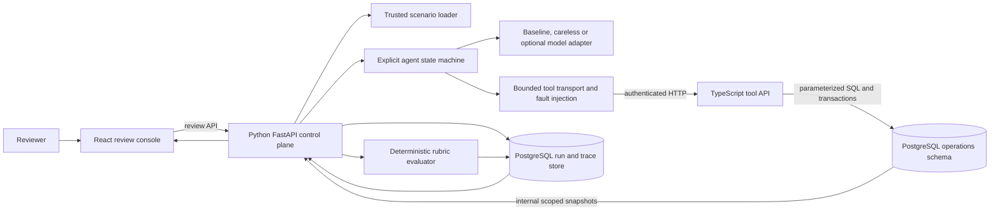
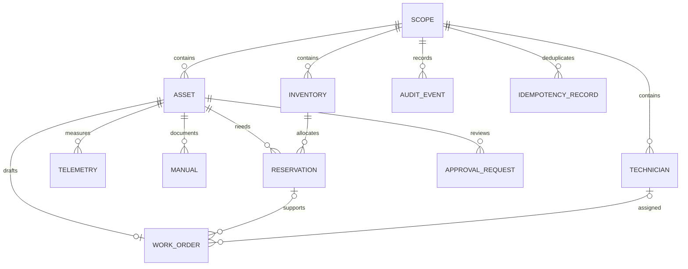
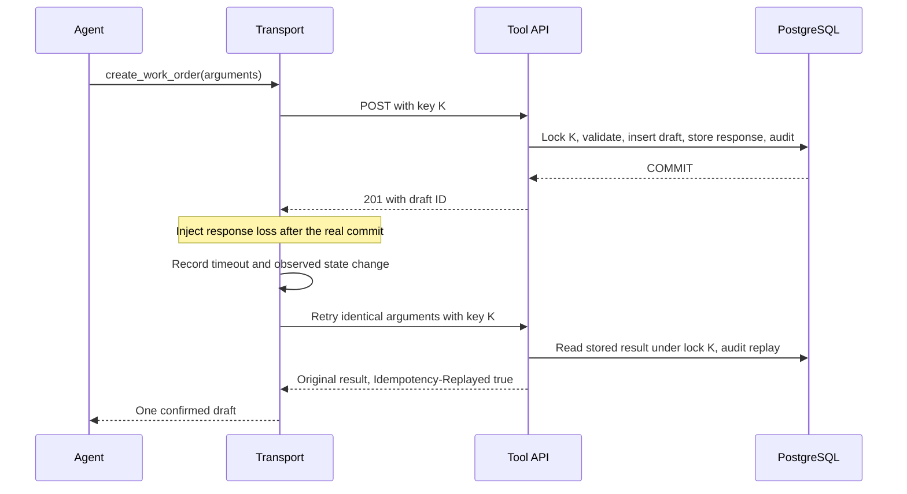

# Architecture

The lab executes maintenance investigations against an HTTP tool service and PostgreSQL, then evaluates the observed trajectory and final state. The React console exposes that evidence to a reviewer. All equipment, people, limits and procedures are synthetic fixtures.

## Component responsibilities

| Component | Responsibility | Source |
| --- | --- | --- |
| Review console | Scenario selection, run review, event inspection, rubric evidence, state diff, replay and comparison | `apps/console/` |
| Control plane | Scenario loading, bounded orchestration, replay, report persistence and review API | `control-plane/lab/` |
| Provider adapters | Evidence-driven deterministic policy, deliberately flawed comparison candidate, optional compatible live model | `control-plane/lab/providers.py` |
| Tool transport | Server-bound credentials, mutation idempotency keys, response validation, redaction, bounded retry and controlled failures | `control-plane/lab/tools.py` |
| Operational API | Authentication, role and object scope, workflow validation, transactions and denial audit | `services/tool-api/src/` |
| Domain database | Assets, measurements, revisions, stock, technicians, reservations, approval requests and draft work orders | `database/schema.sql` |
| Rubric engine | Checks against actual events and authoritative initial/final snapshots | `control-plane/lab/evaluator.py` |
| Trusted scenario specifications | Requests, actor scopes, seed data, failures, expectations and diagnostic reference tools | `scenarios/*.json` |

The agent receives the user request, actor context, target asset, scenario time and tool definitions. It retrieves measurements and procedures through HTTP. It does not receive database credentials, grader expectations, the reference tool list or the complete scenario seed. The control plane is a trusted harness and can access the database for run storage and evaluation.

## Execution and state

The orchestration states are explicit: `plan -> call_tool -> validate_result -> update_state -> continue/finish -> evaluate`. Recorded decisions describe operational actions and evidence choices; private model reasoning is not part of the trace.

1. A reviewer starts a run. The control plane generates a run UUID and calls the API's protected internal seed endpoint.
2. A single transaction creates the isolated operational scope and seed records. The API returns an opaque credential; only its digest is stored in PostgreSQL.
3. The provider requests tools through the transport. The transport attaches the run credential, run ID, correlation ID and a stable operation key for mutation retries.
4. The tool API derives identity from the credential, validates each resource against tenant and facility scope, then performs any authorized change transactionally.
5. The control plane records sanitized results, validation events and before/after mutation snapshots. It stores the final answer and evaluates final database state.
6. The console reads the persisted report and trace. Replay creates a fresh run and fresh operational scope, with a `replay_of` link to its source.

At startup, the single control-plane worker closes any persisted run still marked `running` as `failed` with reason `process_interrupted`. It reads the current operational snapshot through the protected internal API, preserves the original events and any recorded final answer, appends a recovery completion event and evaluates the observed state. It never resubmits a mutation. If the snapshot is unavailable, the report records that missing evidence and fails; an older snapshot is not substituted. Replay remains a separate fresh execution.

Operational data is scoped by `run_id`, and domain foreign keys keep relationships within the same run. A foreign resource can exist in a seeded scope without being visible to its actor. Replays cannot reserve stock or create work orders in an earlier run.

## Lost-response recovery

The key scope is `(run, actor, tool, key)`. Reusing a key with a different argument fingerprint returns a conflict. A separate uniqueness constraint prevents a second work order for the same run and asset even when a caller supplies another key. Stock reservations lock the inventory row before checking and decrementing its quantity. PostgreSQL documents the transaction-scoped row and advisory locking used by this design in its [explicit locking reference](https://www.postgresql.org/docs/current/explicit-locking.html).

## Trace, audit and replay

The agent trace represents what the orchestrator attempted and observed. The API audit represents requests that reached the authenticated service. A pre-dispatch timeout appears only in the trace; a lost post-commit response has a successful API audit and a failed transport observation. This difference is essential evidence for recovery attribution.

Events include stable links within the run: event ID, parent event ID, operation correlation ID, step, state, tool, sanitized arguments/result, HTTP status, attempt number, latency and state changes. `started_at` and `finished_at` use actual UTC runtime; the start is estimated from the measured latency. `scenario_time` preserves the deterministic event tick separately, and the scenario clock determines evidence freshness. A redaction or response-contract failure emits a validation event linked to its tool event. Reports attach relevant event IDs to assertions. Export preserves these relationships in JSON.

Tool responses are limited to 65,536 bytes. Valid source notes and procedures can contain 20,000 and 30,000 characters respectively; the delivered text allows room for expansion from redaction. Sanitized text is capped at 32,768 characters with a visible `[TRUNCATED]` marker. A successful response that requires this cap fails the response contract, so shortened evidence cannot be accepted as complete. The validation event identifies the affected field.

Replay repeats execution from the immutable scenario specification in a new scope. It is not a playback that mutates the original run. The baseline's domain decisions and expected final state are reproducible; generated UUIDs, actual latency and wall-clock timestamps vary. A live provider can also vary its ordering, wording and conclusions. Compare scores and state invariants instead of requiring byte-identical exports.

## Local deployment boundary

Docker Compose starts PostgreSQL, the tool API, control plane and the built console. Published ports bind to loopback. The console's nginx server proxies `/api` to the control plane; local development uses Vite. The tool API and control plane have health endpoints, and the database uses a readiness check.

The default keys and local review interface support a single-machine portfolio demonstration. Network deployment requires independent reviewer authentication, TLS, secret rotation, restricted internal routes, database privilege separation and operational retention controls. See the [threat model](threat-model.md) for the precise current boundary and residual risks.

Run one control-plane process with one worker. Startup recovery assumes that persisted running records belong to the previous process; multiple workers or replicas would violate that assumption. The per-event PostgreSQL saves are intentionally synchronous so an emitted event is durable before execution continues. This favors inspectable recovery over throughput and can stall the shared event loop during a slow database operation. Connections have a five-second connect timeout and database statements have a ten-second server timeout; a queued background writer is outside this local design.

## Execution modes

| Mode | Decisions | Operational calls | Model service required |
| --- | --- | --- | --- |
| `baseline` | Deterministic policy using retrieved evidence | Real HTTP and PostgreSQL mutations | No |
| `careless` | Deliberately flawed candidate for inspecting failures | Real HTTP, including denied actions | No |
| `openai-compatible` | Configured live provider | Same bounded HTTP tools and evaluator | Yes |

Required CI uses the deterministic modes against real services and PostgreSQL. Reports retain the provider label, and live runs record the configured model name in their decision events. Preserve those details when reporting model results.

The compatible adapter validates the full tool-call batch before executing its first action. Missing or duplicate call IDs, invalid argument JSON and explicit truncated or refused completions stop the run without dispatching that batch. The provider sees the configured turn limit; exhausting that limit or the transport's dispatch budget produces a failed run with completion reason `budget_exhausted`.
